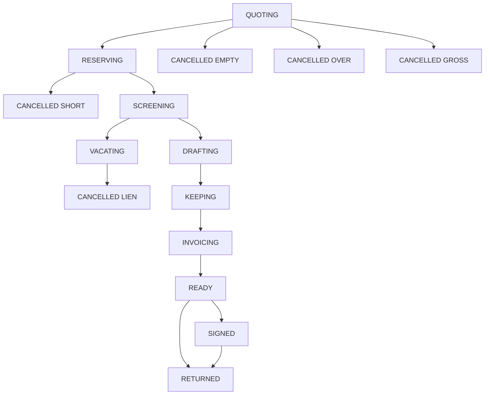
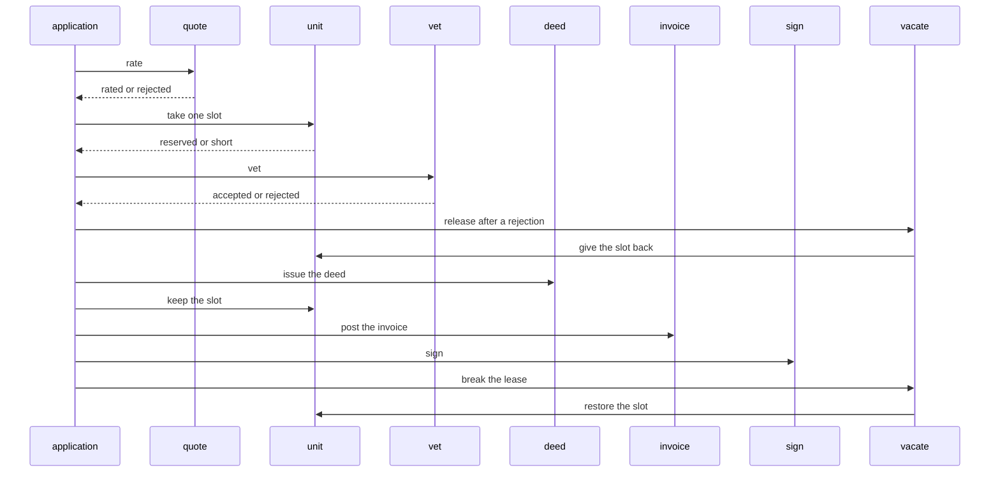

# Lease Desk

A unit has open slots. An application is rated from its months and the unit's rent. The unit service keeps one slot, or leaves the unit alone when no slot is open. A tenant whose code contains `lien` is rejected after the slot is kept, and a release gives it back. A break after the application is ready gives the slot back as well. It does not roll the deed back.

Thirteen services each own one Postgres database. The application service is the saga orchestrator. It does not call the others over HTTP. A step commits its own row and an outbox message in one local transaction. A relay publishes that message. The next service claims an inbox key before it writes.

The unit service is the only writer of the open slots and of the hold. A slot is subtracted only while one remains. A release or a break adds that slot back only while this application still holds it. Twelve months at 100 cents is 1200. Twenty-four months still rates. One month past that cancels over, before a slot is kept. Zero months cancels empty. A rent that overflows the integer range cancels. An application when the unit has no open slot is short. `unliened` matches a lien code.





The relay can publish a message and crash before it marks the row sent. The broker then holds a second copy. Consumers dedupe with the inbox key. The saga moves an application forward only from the status that step expects, so a repeated fact does not apply twice. There is no distributed transaction.

## Services

| Service | Owns | Port |
| --- | --- | --- |
| owner-service | the owner | http://localhost:8306 |
| building-service | the open building | http://localhost:8307 |
| tenant-service | the tenant | http://localhost:8308 |
| floor-service | the open floor | http://localhost:8309 |
| unit-service | the slots and the hold | http://localhost:8310 |
| application-service | the application and the saga | http://localhost:8311 |
| quote-service | months times the rent | http://localhost:8312 |
| vet-service | the lien decision | http://localhost:8313 |
| deed-service | the deed | http://localhost:8314 |
| invoice-service | the posted invoice | http://localhost:8315 |
| sign-service | the signature after the application is ready | http://localhost:8316 |
| vacate-service | the release and the break | http://localhost:8317 |
| audit-service | one row per fact | http://localhost:8318 |

Postgres is `localhost:5450`. Kafka's host listener is `localhost:9111`. RabbitMQ management is http://localhost:15690.

## Run

```bash
mvn -q -DskipTests package
docker compose up --build -d
./scripts/smoke.sh
docker compose down
```

```bash
curl -s -X POST localhost:8306/owners \
  -H 'content-type: application/json' \
  -d '{"ownerCode":"OW-1","name":"North Owner"}'

curl -s -X POST localhost:8307/buildings \
  -H 'content-type: application/json' \
  -d '{"buildingCode":"BD-1","status":"OPEN"}'

curl -s -X POST localhost:8308/tenants \
  -H 'content-type: application/json' \
  -d '{"tenantCode":"T-1","name":"Ada"}'

curl -s -X POST localhost:8309/floors \
  -H 'content-type: application/json' \
  -d '{"floorCode":"FL-1","buildingId":"BUILDING","status":"OPEN"}'

curl -s -X POST localhost:8310/units \
  -H 'content-type: application/json' \
  -d '{"unitCode":"UN-1","ownerId":"OWNER","buildingId":"BUILDING","slots":4,"rentCents":100}'

curl -s -X POST localhost:8311/applications \
  -H 'content-type: application/json' \
  -d '{"requestId":"application-1","ownerId":"OWNER","buildingId":"BUILDING","tenantId":"TENANT","floorId":"FLOOR","unitId":"UNIT","months":12}'
```

The same `requestId` returns the original application and does not keep the slot again.

## Where the same split goes on AWS

This repository runs on Compose. Nothing in it calls a cloud account.

| Compose | AWS |
| --- | --- |
| Postgres 16 | RDS for PostgreSQL |
| Kafka 3.8 | MSK |
| RabbitMQ 3.13 | Amazon MQ, or SQS with a dead-letter queue |
| the thirteen services | ECS or EKS |

## Local credentials

The Compose network is local and unauthenticated. Do not publish these ports.

| | |
| --- | --- |
| Postgres | `platform` / `platform` |
| RabbitMQ | `platform` / `platform`, vhost `/` |
| HTTP | no authentication |

## Tests

`mvn test` checks an empty term, a term past 24 months, an integer overflow of months times the rent, the 1200 cent fee, a unit with no open slot, and a tenant code that contains `lien`. `./scripts/smoke.sh` signs an application and then breaks it, cancels an empty term, an over term, and a rent overflow without a slot, leaves the unit alone when the application is short, dead-letters a lien tenant and gives that slot back, and runs two overlapping cases: two applications on one unit, and a signature racing a break.

## Same shape, different domain

- [Live Lobby](https://github.com/joshbarros/java-live-lobby)
- [Loyalty Ledger](https://github.com/joshbarros/java-loyalty-ledger)
- [Claims Desk](https://github.com/joshbarros/java-claims-desk)
- [Checkout Counter](https://github.com/joshbarros/java-checkout-counter)
- [Study Hall](https://github.com/joshbarros/java-study-hall)
- [Clearing Desk](https://github.com/joshbarros/java-clearing-desk)
- [Thread Hall](https://github.com/joshbarros/java-thread-hall)
- [Yard Gate](https://github.com/joshbarros/java-yard-gate)
- [House Account](https://github.com/joshbarros/java-house-account)
- [Procure to Pay](https://github.com/joshbarros/java-procure-to-pay)
- [Policy Bind](https://github.com/joshbarros/java-policy-bind)
- [Plant Order](https://github.com/joshbarros/java-plant-order)
- [Meter to Cash](https://github.com/joshbarros/java-meter-to-cash)
- [Carrier Desk](https://github.com/joshbarros/java-carrier-desk)
- [Payroll Desk](https://github.com/joshbarros/java-payroll-desk)
- [Grant Desk](https://github.com/joshbarros/java-grant-desk)
- [Clinic Desk](https://github.com/joshbarros/java-clinic-desk)
